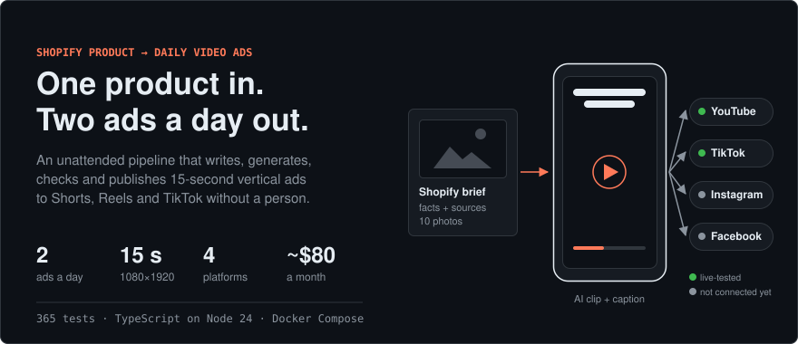
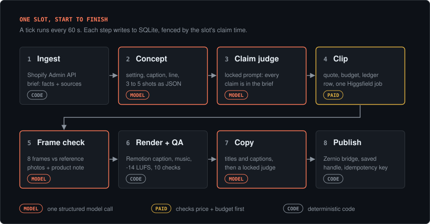
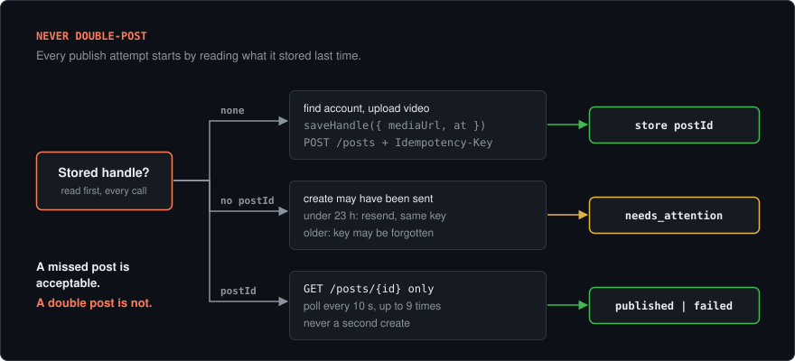
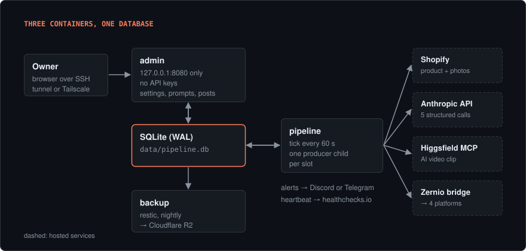

<p align="center">
  <picture>
    <source media="(prefers-color-scheme: dark)" srcset="assets/readme/hero-dark.svg">
    <source media="(prefers-color-scheme: light)" srcset="assets/readme/hero-light.svg">
    
  </picture>
</p>

<p align="center">
  <strong>An unattended pipeline that turns one Shopify product into two 15-second video ads a day and posts them to Shorts, Reels and TikTok.</strong><br>
  <sub>TypeScript on Node 24, SQLite, Remotion, the Claude API, Higgsfield for video and Zernio for publishing. Runs as three Docker Compose services on a small VM.</sub>
</p>

<p align="center">
  
  
  
  
  
  
  
</p>

---

## The problem

A small online store needs short vertical videos to get seen. Each one takes time: someone writes a script, films or generates a clip, edits it, writes four sets of captions, and uploads it to four apps. Two a day is about 60 videos and 240 posts a month, too much for one person who also runs the store.

Handing the job to software creates new problems. A language model will happily invent a discount, a review or "keeps you warm for 8 hours", and an ad may only say what the store's data says. A crash or timeout halfway through an upload must not post the same video twice. AI video can show the wrong product, misspell the shop's name, or come out silent or black, and nobody watches it before it goes live. Video generation costs money, so a retry loop could spend the month's budget in an afternoon. And one product has to carry 60 different videos a month without the feed looking like a loop.

## The solution

The pipeline is ordinary, deterministic code driven by a SQLite database. A tick runs every 60 seconds, plans tomorrow's slots, and produces one slot at a time in a child process. Language models are called at five steps only, each as one request with a structured answer. There are no agent loops and no long-lived model sessions.

<p align="center">
  <picture>
    <source media="(prefers-color-scheme: dark)" srcset="assets/readme/pipeline-dark.svg">
    <source media="(prefers-color-scheme: light)" srcset="assets/readme/pipeline-light.svg">
    
  </picture>
</p>

1. **Ingest.** The product comes from the Shopify Admin API (or the public `/products.json` feed as a fallback) and becomes a brief: each fact with the field it came from, the disclosures that must appear, and a photo inventory. Photos with printed supplier text are cropped to clean regions.
2. **Concept.** A model writes a scene as JSON: a setting, a caption of at most 12 words, at most one spoken line, and three to five shots that add up to 15 seconds. Code checks it for numbers, prices, banned phrases and repeats of recent captions.
3. **Claim judge.** A second call, with a prompt the owner cannot edit, rejects any statement the brief does not support. Tags are not claims. The accepted concept is saved before any money is spent.
4. **Clip.** Code checks the Higgsfield balance, gets a quote and writes a ledger row, then submits one paid job. A monthly cap and a tier router fall back to reusing a stored clip when the budget or sign-in is gone.
5. **Frame check.** A vision call looks at eight frames next to the product's reference photos and returns a verdict that code turns into pass or fail: wrong product, a misspelled shop name, overlaid text or a generation fault all fail. Five runs on each of five labelled clips gave the expected verdict 25 times out of 25.
6. **Render and QA.** Remotion adds the caption and an owner-uploaded music track, loudness is normalised to -14 LUFS, and the file must pass ten checks with FFmpeg and ffprobe: codec, 1080×1920 at 30 fps, 14 to 16 seconds, fast start, loudness, silence, black frames and frozen picture.
7. **Copy.** A model writes the title, caption and hashtags for each platform from what the video shows, and a locked judge checks them against the brief.
8. **Publish.** The Zernio bridge posts to each enabled platform. `DRY_RUN=1` skips this call and nothing else.

### Never double-post

<p align="center">
  <picture>
    <source media="(prefers-color-scheme: dark)" srcset="assets/readme/publish-dark.svg">
    <source media="(prefers-color-scheme: light)" srcset="assets/readme/publish-light.svg">
    
  </picture>
</p>

A publisher saves a handle before any request that could create a post, and reads that handle first on every attempt. No stored handle means nothing was posted. The create request carries `Idempotency-Key: <slot>:<platform>`, so a retry after a timeout is safe. If the state can't be resolved, the publication becomes `needs_attention` and the owner gets an alert. Every write after a claim carries the claim time as a fencing token, so a stale process can't overwrite a newer one. A second run against a live private YouTube video and a TikTok draft resumed both from the stored handle without posting again.

## Architecture

<p align="center">
  <picture>
    <source media="(prefers-color-scheme: dark)" srcset="assets/readme/services-dark.svg">
    <source media="(prefers-color-scheme: light)" srcset="assets/readme/services-light.svg">
    
  </picture>
</p>

The database is the only channel between the services. The admin page is a small private web app, reachable only through an SSH tunnel or Tailscale. The owner uses it to edit settings and prompts (every change is versioned and can be rolled back), upload music, choose video models, and make a post on demand that waits for an explicit Post or Discard. It holds no API keys. The pipeline rereads config and prompts every tick, so a change applies without a restart. A nightly encrypted snapshot goes to Cloudflare R2 with restic, a daily summary and alerts go to Discord or Telegram, and healthchecks.io raises an alarm if the pipeline stops checking in.

| Area | Tools |
|---|---|
| Runtime | Node 24 running TypeScript directly (no build step), `node:sqlite`, `node:test`, `fetch` |
| Models | Claude API through `@anthropic-ai/sdk`, structured output, monthly spend cap |
| Video | Higgsfield over MCP with OAuth, Remotion 4 for captions and the final render, FFmpeg for QA |
| Voice and music (`ad` mode) | Kokoro-82M on CPU with word timestamps, a synthesised music bed in NumPy |
| Publishing | Zernio bridge for YouTube Shorts, TikTok, Instagram Reels and Facebook Page Reels |
| Ops | Docker Compose, restic to Cloudflare R2, healthchecks.io, Discord or Telegram alerts |
| Config | zod-validated config file plus versioned overrides from the admin page |

Every dependency is pinned to an exact version and recorded with its licence and the alternatives considered in [`docs/INSTALLED.md`](docs/INSTALLED.md) and [`docs/DECISIONS.md`](docs/DECISIONS.md).

## Cost

About US$77 to $84 a month with two platforms connected, under a $100 budget.

| Line | Monthly |
|---|---|
| Higgsfield subscription (3,000 video credits) | $65, flat |
| VM, 4 vCPU / 8 GB | $10 to $17 |
| Claude API | about $2, capped at $10 |
| Zernio bridge | $0 with two platforms, $12 with all four |
| Backups, alerts, monitoring | $0 on free tiers |

One paid end-to-end slot (one Wan 3.0 clip plus all model calls) cost $0.59 and was ready in 395 seconds. See [`docs/COSTS.md`](docs/COSTS.md).

## Getting started

You need Docker with Compose, an Anthropic API key, a Higgsfield account, a Zernio account with the platforms connected, and a Shopify store. [`STARTUP.md`](STARTUP.md) walks through the whole setup, and [`docs/OWNER_SETUP.md`](docs/OWNER_SETUP.md) is the detailed reference.

1. Create the env files and fill in the keys listed in `.env.example`:

   ```bash
   cp .env.example .env && cp .env.backup.example .env.backup && chmod 600 .env .env.backup
   ```

2. Build the image. The first build downloads Chrome Headless Shell and the voice model:

   ```bash
   docker compose build
   ```

3. Sign in to Higgsfield once. The token is stored in the database volume:

   ```bash
   docker compose run --rm pipeline node src/cli.ts auth higgsfield
   ```

4. Start everything and check it:

   ```bash
   docker compose up -d
   docker compose run --rm pipeline node src/cli.ts doctor
   ```

`DRY_RUN=1` is the default, so nothing is posted until you set `DRY_RUN=0` in `.env`. A dry run still calls the models and still spends video credits. To spend nothing, also set `LLM_STUB=1` and use the `fake` clip provider with `CLIP_STUB_FILE`.

For development:

```bash
npm test                                   # 365 tests, node:test
npm run typecheck                          # tsc --noEmit
DRY_RUN=1 node src/cli.ts run --once       # one tick, no publish call
```

## Status

| Phase | State |
|---|---|
| Ingest, creative, tiers, QA | Done |
| Publishing | YouTube and TikTok tested live and privately. Facebook and Instagram not connected yet |
| Scheduler, ops, admin | Built and tested. The first full real day has not run |
| Deploy to a VM, 48-hour unattended run | Not started |
| Weekly feedback loop from platform analytics | Not started |

[`docs/STATUS.md`](docs/STATUS.md) has the details, including what has and hasn't been verified live.

## Known limitations

- It handles one product. Ingest reads more, but the creative step is tuned for a single listing.
- A fresh install has no stored clips for the first 14 days, so a slot that can't make a new clip fails or waits.
- The frame check is reliable on Wan 3.0 clips and splits on one Seedance 2.0 sample.
- `ad` mode (voice-over over animated product photos) works, but `ugc` mode is the default and gets more testing.

## Documentation

| File | What it covers |
|---|---|
| [`docs/ARCHITECTURE.md`](docs/ARCHITECTURE.md) | Data flow, slot and publication states, retry rules, QA gate, security |
| [`docs/DECISIONS.md`](docs/DECISIONS.md) | Every tool and service choice, with the alternatives and why |
| [`docs/PLATFORMS.md`](docs/PLATFORMS.md) | The platform and bridge API facts the publishers depend on |
| [`docs/COSTS.md`](docs/COSTS.md) | The monthly budget line by line |
| [`STARTUP.md`](STARTUP.md) | Running it locally, hosting it on a VM, day-to-day use |
