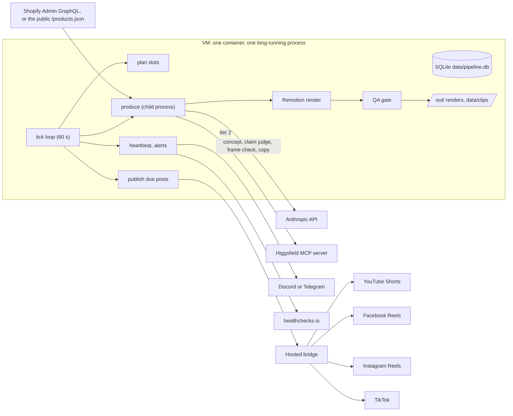

# Architecture

A single container on a small VM turns the store's Shopify product into two 15-second vertical
videos a day and publishes each one to YouTube Shorts, Facebook Page Reels, Instagram Reels and
TikTok. The pipeline is ordinary code driven by a SQLite database. Language models are called only
at the creative and judgment steps listed under "Model use at runtime". Nothing listens on a network
port, except a loopback listener for the one-time Higgsfield sign-in.

Two creative formats exist, chosen by `creative.mode` (D-28). `ugc`, the default, is one
AI-generated 15-second scene that looks like something a person filmed, with one caption at the top
of the frame. `ad` is the earlier photo ad: a scripted voice-over over animated product photos, with
an end card. Everything outside the creative step is shared.

## What we are advertising

Read from the live store on 2026-11-11:

| | |
|---|---|
| Store | Giftwell (formerly Merry Marts), Oakville, Ontario. Prices in CAD. Ships to Canada only |
| Products | 1: Heated Shawl Wrap (`snugwrap-heated-shawl-wrap`), $49.99 CAD |
| Variants | Beige, Green, Red. One size, 150 × 80 cm |
| Photos | 10, square, 800–1500 px. Six are supplier infographics with claims printed on them |
| Description | About 60 words: heating function, USB-powered, wearable, materials, gift-box packaging, "Power bank not included" |
| Reviews, sale price | None |

Three consequences shape the design. The facts available for claims are few, so the claim checker
matters, and every post carries the brief's disclosure ("power bank not included") in its text. One
product has to carry 60 distinct videos a month, so variation is part of the system. And most photos
carry printed text, so each photo is cropped to a text-free region before it is used or sent out.
What the product looks like is not in Shopify's data, so the owner writes it in
`config/product-notes.json`.

## Diagram



## Data flow for one slot

### `ugc` mode (default)

1. **Plan.** The planner creates a slot row and one publication row per enabled platform for each
   slot time that is still in the future. The tick plans tomorrow from `produceAt` (21:00 local) and
   plans today if it has no slots. The planner makes no creative choices.
2. **Produce.** The tick starts `produce --slot` in a child process for the oldest planned slot.
   `produceSlot` claims it with one atomic update and the claim time fences every later write.
3. **Ingest.** The product is fetched at most once a day, under a five-minute deadline. The Admin
   API is used when `SHOPIFY_CLIENT_ID` and `SHOPIFY_CLIENT_SECRET` are set, and the public feed
   when they are not or when the Admin call fails. The result becomes a brief: facts with the field
   each came from, disclosures, and a photo inventory. A failed ingest alerts and the stored brief
   is used. With no stored brief the slot goes back to `planned`.
4. **Tier.** `chooseTier` draws a tier from the slot id. With the default mix every slot draws
   tier 2. It falls back to tier 0, which means "reuse a stored clip", when the provider is not
   signed in or the monthly cap is reached.
5. **Concept.** The script model writes a concept as structured JSON: a setting, one woman, a
   product colour, one caption of at most 12 words, at most one spoken line of at most 9 words, and
   three to five shots whose seconds add up to the clip length. Code checks the caption and line
   against the brief (numbers, prices, banned phrases, repeats of recent captions), then the claim
   judge checks that no statement is unsupported. One retry lists the problems. The accepted concept
   is stored in `slots.master_json` before any paid job starts, so a crash leaves the concept the
   job was made from.
6. **Clip.** The prompt is built from the concept, the owner's product note, up to two cropped
   product photos in the concept's colour, and the logo from `brand.logo`. The router checks price
   and balance, then submits one job to Higgsfield and waits for the video. The clip must be at
   least 14 s with a short side of at least 480 px.
7. **Frame check.** A model looks at eight frames of the new clip against the product photos and
   the owner's note. The verdict is computed in code from its answers (see "QA gate"). A clip that
   fails is rejected, and the slot may start one more job, up to `tiers.maxJobsPerSlot` jobs in
   all, each with a new concept.
8. **Caption render.** Remotion draws the one caption over the clip, below the tallest top safe
   zone of the enabled platforms, and the audio is normalized to −14 LUFS. The file goes through the
   QA gate. A file that fails counts as a rejected clip.
9. **Reuse.** If no new clip could be made (tier 0, cap reached, credits low, signed out, concept
   writer failed, or every job rejected), the slot reuses a stored clip of the product that was last
   posted at least `ugc.reuseAfterDays` days ago, with the concept it was made from. The concept
   must still pass the checks against the current brief. The slot sends a `degraded` alert, then
   renders and checks the clip again. With none available the slot fails and alerts (or waits, if
   the cause was a passing model outage). It does not fall back to a photo ad.
10. **Copy.** The copy model writes the title, caption and hashtags for the four platforms in one
    call and a second call judges them. Code adds the product link where captions are clickable
    (YouTube, Facebook) and the brief's disclosures. If the model fails, deterministic copy from the
    brief is used.
11. **Commit.** The one rendered file is copied once per enabled platform. In one transaction the
    slot becomes `ready` and the render rows are written, fenced by the claim time. The slot's cost
    is the sum of its model calls and its ledger rows.
12. **Publish.** At each platform's time the publisher posts the file through the bridge (see
    "Never double-post"). The AI label is always on, because every video is AI-generated.

A frame-check error, meaning the model call itself fails rather than the clip being judged bad,
does not lose the paid clip. A rate limit or 5xx puts the slot back to `planned` without using an
attempt. Any other error does so while `attempt < render.maxAttempts`. The next attempt finds the
paid clip in the ledger and the concept in `master_json`, and so does not pay twice. See "Retry".

### `ad` mode (alternative)

The same steps 1, 2, 3 and 10 to 12 apply. In between:

- **Hook.** The hook library is refilled by the script model, and the least recently used hook
  outside its `hooks.noRepeatDays` window is picked. If the model is unavailable or no hook is free,
  the slot reuses the script of an old slot that still passes every check, and alerts.
- **Script.** The script model writes four beats (hook, benefit, offer, call to action) as
  structured JSON. Code checks word counts, price strings and banned phrases, then the claim judge
  checks each chunk against the brief. One retry lists the problems.
- **Tier.** Some slots open with one image-to-video clip made from a product photo. Any failure
  leaves the slot at tier 0. The default config draws tier 2 for every slot, so for `ad` mode set
  the mix to all tier 0.
- **Voice.** Kokoro synthesizes the lines on the VM and returns word timings. If speech runs past
  the limit it is synthesized again at up to 1.12 times speed. If it still does not fit, the script
  is regenerated once, and then the slot fails.
- **Master edit.** The script, shots, voice, music and clip are assembled into one edit list.
- **Render.** Remotion renders the edit once per enabled platform, changing only the safe zones and
  the call-to-action wording, and each file goes through the QA gate and a caption-style check. A
  failure renders the whole slot again with the next template, once.

## Runtime shape

One Docker image, one service, started with `docker compose up -d` and restarted by Docker
(`restart: unless-stopped`). The image's command is `node src/cli.ts run`. Compose sets `DRY_RUN=1`
unless the environment says otherwise.

The process runs a tick once a minute. Every job reads the database to decide whether it has work,
so a crash, a restart or a missed minute changes nothing. A tick that runs longer than
`watchdogMinutes` (45) makes the process exit so Docker restarts it. The watchdog is not armed for
`run --once`, whose tick waits for every producer and each producer has its own timeout.

| Step in the tick | Does |
|---|---|
| Plan | Creates slot and publication rows as described above |
| Stale recovery | A `producing` slot not touched for `render.produceTimeoutMinutes` (90) goes back to `planned`, or fails with an alert once `attempt` reaches `render.maxAttempts` (2) |
| Produce | Starts one child process for the oldest planned slot if none is running. A planned slot that has an error waits 10 minutes after the attempt ended (not after it was claimed). A planned slot with no pending publication inside the lateness window fails as "too late" |
| Publish | `publishDue`: recovers stale rows, skips overdue ones, posts the ones due |
| Heartbeat | Written at the start of the tick, so a long publish still shows the loop alive, and again at the end. The end also pings `HEALTHCHECK_URL` if set |

Rendering runs in a child process so that an out-of-memory kill takes the child and not the loop,
and publishing continues while a render is in progress. The produce timeout is 90 minutes, enough
for two video jobs of 40 minutes each (25 of polling, 10 of download, uploads and margin; the config refuses less than `maxJobsPerSlot * 40 + 10` in `ugc` mode). After the
timeout the child gets SIGTERM,
which cancels its Chrome, and 20 seconds later its whole process group gets SIGKILL. `run --once`
produces every planned slot before it publishes, which is how the dry run is exercised.

CLI commands: `run [--once]`, `plan`, `publish`, `produce --slot ID`, `ingest [--print]`,
`samples`, `doctor`, `health` and `auth higgsfield`. `--now ISO` moves the clock. Only `cli.ts`
reads the clock.

There is no cron, no Redis, no queue broker and no web server. The database is the queue.

## Slot and publication states

```
slot:         planned -> producing -> ready -> done
                 ^           |  \-> failed          (alert; publications skipped)
                 \-----------/  back to planned: stale claim, no brief,
                                a passing outage, or a retry after a paid clip

publication:  pending -> uploading -> published
                 |            \-> pending (retry with backoff)
                 |            \-> skipped (permanent error or retries exhausted, with no handle)
                 |            \-> needs_attention (ambiguous, or a handle is stored; alert; never re-posted blindly)
                 \-> skipped (slot failed, or more than maxLateness past its time, with no handle)
                 \-> needs_attention (the same two cases, with a handle stored)
```

A slot ID is `<local date>#<index>`, for example `2026-11-12#1`. A publication is keyed by
`(slot_id, platform)`. A slot becomes `done` when none of its publications is `pending` or
`uploading`.

**Claiming.** A publication is claimed with one statement,
`UPDATE … SET state='uploading', claimed_at=… WHERE state='pending'`, and the post goes ahead only
if that statement changed a row. The claim time is a fencing token: every later write to the row
names it, and a write that no longer matches is dropped. The same holds for slots, with
`claimed_at` on `slots`. A manual `publish` beside the loop cannot take the same row.

**Recovery.** A crash can leave a row in `producing` or `uploading`. Rows older than their timeout
(`render.produceTimeoutMinutes` for slots, `publish.uploadTimeoutMinutes` for publications, 90 and 30
minutes) are taken over. A stale `uploading` publication with no stored handle goes back
to `pending`, because nothing was posted. One with a handle is run again, which resumes from the
handle. If it is also past `maxLatenessMinutes`, or has used more than `retryMinutes.length + 1`
attempts, it becomes `needs_attention`. A stale row is left alone in a dry run.

### Never double-post

The bridge publisher (`src/publish/bridge.ts`) follows the contract in `src/publish/types.ts`: call
`saveHandle` before any request that could create a post, use the stored handle first on every call,
and pass `signal` to every request. No stored handle means nothing was posted.

1. The handle is `{ mediaUrl, at, postId? }`.
2. With a `postId`, the publisher only reads the post (`GET /posts/{id}`) and polls every 10 seconds
   until the platform's status is `published`, `failed` or `cancelled`. It stops after nine polls
   (90 seconds) with a retryable "still publishing", and the next attempt reads the stored post
   again. A post that cannot be read while we hold its id is `needs_attention`. It never sends a
   second create request.
3. With a handle but no `postId`, the create request may have been sent. If the handle is more than
   23 hours old, the bridge may have forgotten the key (it keeps it 24 hours), so the result is
   `needs_attention`. Otherwise the request is sent again with the same key.
4. With no handle, the publisher finds the account by handle, uploads the video to a pre-signed URL
   if needed, and calls `saveHandle({ mediaUrl, at })`. Only then does it send `POST /posts`.
5. The create request carries `Idempotency-Key: <slot id>:<platform>`, which is stable across
   retries. A 409 that names an existing post is adopted: its id is stored and read back. The post id
   is saved as soon as the response arrives.
6. A post the bridge reports as failed or cancelled is final and is not retried: a missed post is
   acceptable, a double post is not.
7. A publication with a stored handle is never marked `skipped`. When retries run out, or it is too
   late or its slot failed, it becomes `needs_attention`, because a request may have been sent.

If the state cannot be resolved (unreadable handle, expired key, a render missing after a handle was
stored, an unexpected error), the publication becomes `needs_attention` and an alert goes out.

### Retry

A network error, a timeout, HTTP 5xx or 429, and an idempotency conflict are retryable. The row goes
back to `pending` with `next_attempt_at` at 1, 5, 15, 45 and 120 minutes (`publish.retryMinutes`).
When that list is exhausted the publication is `skipped` with an alert, or `needs_attention` if a
handle is stored. Any other 4xx, a missing
bridge account, a post the bridge reports as failed, and a refused `private` Instagram post are
permanent: the publication is `skipped` and an alert goes out, or `needs_attention` if a handle is stored. A publication more than
`maxLatenessMinutes` (360) past its time is skipped, so a long outage never produces a burst of
posts. One publish call is cut off after `publish.timeoutMinutes` (20), which is less than the
30-minute recovery timeout.

**Retry of a slot.** A passing outage (a model rate limit or 5xx, a paid clip that cannot be fetched
yet) puts the slot back to `planned` and gives back the attempt, with one `degraded` alert. A clip job is waited for at most 2 hours after it was created; then it is marked `failed` and the slot uses a stored clip. A concept-writer outage with no stored clip gives the attempt back once per slot; a repeat uses it. The
same holds for no stored brief, with an `ingest_failed` alert. Any other error after a clip was paid for does the same while `attempt < render.maxAttempts`,
but uses the attempt. Any other error fails the slot. The tick waits 10 minutes before it tries a
planned slot that has an error, and the "too late" rule ends the wait (D-31).

## Creative pipeline

**Brief.** Built from Shopify data only. Each fact records its source field. Tags are used for
angle selection and never as claims. Each photo's usable shots come from `config/photo-tags.json`,
which the owner edits: a crop free of printed text, what it shows and the colour variant. A photo
with no entry is used whole. Tagging photos with a vision model is planned and not built. Claims that
appear only as text printed on a photo are never used. The brief also extracts disclosures.

**`ugc` concept.** See steps 5 and 6 above. The caption and the spoken line may state an opinion,
never a fact the brief lacks. The woman is a character in a scene and is never presented as a
customer giving a review. The picture carries no price, logo overlay, end card or call to action.
The video model makes the voice and the room sound, so there is no voice-over and no music bed. The
spoken line is not transcribed at run time (D-28).

**Caption render.** `templates/Ugc.tsx` draws one caption, `ugc.captionPx` (84) wide on the
1080-pixel frame, below the tallest top safe zone plus 30 px. One render serves every platform.

**`ad` mode only.**

- *Hook library.* The script model writes hooks in six frameworks. A hook is usable if no slot has
  used it in `noRepeatDays` (14). The library floor is `noRepeatDays × slots per day × poolFactor`
  (14 × 2 × 1.5 = 42), and it is refilled by 24 whenever it is below the floor.
- *Script.* Four beats: hook, benefit, offer, call to action with shop name and URL. Each caption
  chunk has what is said ("forty-nine ninety-nine") and what is shown ("$49.99").
- *Voice and caption timing.* Kokoro-82M runs through a small Python CLI and returns a WAV plus
  per-word times. Captions are the script itself, timed by the synthesizer. Speech must end by
  14.8 seconds.
- *Music.* A small Python tool synthesizes an instrumental bed from the slot's seed. Music is ducked
  under the voice and the mix is normalized to −14 LUFS.
- *Render.* A Remotion composition takes the master edit as props. Three templates exist: bold
  kinetic type, soft lifestyle, and gift-guide cards. The end card shows the exact price string from
  Shopify, the shop name and the product URL.

## Variation

In `ugc` mode variation comes from the concept writer, which is given the last 20 captions and
settings and the ones rejected in this slot and may not reuse them, and from the stored-clip rule
for reuse. A caption that repeats a recent one after case and punctuation are removed is rejected.

In `ad` mode a slot is a point in this space, and the variant is a pure function of the slot id:

| Dimension | Rule |
|---|---|
| Hook | Not used by any slot within 14 days |
| Template | Never the previous slot's template |
| Palette | Chosen from three per template |
| Voice | Rotates through `creative.voices` by slot order |
| Music | A seed from the slot id |

Learned weights are planned (see "Feedback loop").

## Feedback loop

Planned. Nothing here is built: there is no `metrics` table, no `src/feedback` and no `metrics` or
`review` command.

Weights would be computed in code. The model would not set them.

- **Metric.** Per post: average watch time divided by video length, where the platform reports it.
  Otherwise likes plus comments plus shares, divided by views. Metrics are read 48 hours after
  publishing.
- **Normalizing.** A post is a win if it beats the median of the last 30 days on its own platform.
  Platforms are never compared with each other.
- **Sampler.** Thompson sampling over hook framework and template, each with a win and a loss count.
  The `hooks` table already has `wins` and `losses` columns.
- **Pruning.** A hook with three losses and no win is retired.
- **Review.** Once a week the script model reads the results table and writes a short commentary and
  angle suggestions.
- **Gaps.** A platform without readable metrics is left out of the ranking. The bridge offers
  analytics (`GET /v1/analytics`; views, likes, comments and shares for YouTube and TikTok), read
  from its documentation and not yet called (D-29).

## Tier router and budget

| Tier | Meaning | Provider | Default share |
|---|---|---|---|
| 0 | No new clip. `ugc` mode reuses a stored clip. `ad` mode uses photos only | none | 0% |
| 1 | An open-weight clip from a hosted API | none: `tiers.t1` is in the config but no provider exists | 0% |
| 2 | A premium-model clip made on the owner's Higgsfield subscription credits | Higgsfield MCP server | 100% |

A tier 1 draw behaves as tier 0. The tier is drawn from a hash of the slot id and the mix.

**Provider.** `src/router/mcp.ts` is a minimal MCP client over `fetch` (JSON-RPC, no model, no SDK).
`higgsfield-auth.ts` signs the owner in once with `node src/cli.ts auth higgsfield` (authorization
code with PKCE, the client registers itself) and keeps the tokens in `oauth_tokens`. A refused access
token is refreshed once and the call retried, except the paid call. `higgsfield.ts` is the provider.
The default model is Wan 3.0 at 720p with generated audio, 15 seconds, 9:16.

**Credits and the ledger.** The ledger is in dollars: `tiers.t2.usdPerClip` is the quoted credits
times what a credit costs on the plan. It records the configured price, not the live quote (known
gap). Before a new job the provider reads the live balance and asks the server for the quote. Just
before the paid call it asks again for the exact request, reference images included. The job is
refused when that quote is above `maxCredits` (30) or when the balance after it would be below
`keepCredits` (350), which sits above Higgsfield's auto-refill threshold so the pipeline cannot
trigger an automatic purchase. A quote answer that holds a started job, or no positive number,
stops clips. A refusal alerts once a day and the
slot reuses a stored clip. With no stored sign-in the tier falls back to 0 without an alert. If the
stored sign-in is refused and cannot be refreshed, a `clip_sign_in` alert goes out.

**Monthly cap.** `tiers.capsUsd` limits each paid tier per UTC month. The month's total counts every
ledger row of the tier, in any state, at its quoted price, so failed and rejected jobs count. A draw
that would pass the cap falls back to tier 0 and alerts once for that month. A slot that already has
a `submitted` or `succeeded` job keeps its tier even at the cap, so a job that was paid for is
always fetched.

**One job at a time, never twice.** The ledger row is written before the job is submitted, and the
provider's job id is stored on it before the router waits. Per slot, `generateClip` goes in this
order:

1. A `succeeded` row whose file exists: copy the file and return. This is how a retry reuses a paid
   clip.
2. A `submitted` row: fetch that job and never submit another. If the fetch fails for a reason
   other than the job having ended, the row stays `submitted`, the slot goes back to `planned` and
   the same job is fetched next time. If the provider is signed out, the slot waits the same way
   and a sign-in alert goes out. Only a job the server reports as ended (a failed or cancelled job,
   no result URL, a disallowed result host, an oversize file) is marked `failed`.
3. A `reserved` row means a crash between reserving and storing the job id. It is marked failed and
   nothing is submitted, because whether the job exists is unknown.
4. Otherwise a new job, only if the slot has fewer than `maxJobsPerSlot` (2) rows, the provider is
   signed in and the cap allows it.

`generate_video` has no idempotency key, so a call whose outcome is unknown is never repeated and a
crash at that moment can cost one clip. A failed or rejected job counts at its quoted price. A job
is polled for at most 25 minutes per fetch (a deadline, not a poll count), and the result is downloaded only from an https host on Higgsfield's
or CloudFront's domain, at most 300 MB.

The ledger is the first limit. The second is outside our code: the Anthropic workspace has a spend
limit equal to the model cap, and the Higgsfield plan grants a fixed number of credits a month.
Unverified: that the workspace limit is set.

## QA gate

Nothing is published without passing. `runQa` reads the finished file and reports ten checks; if
the file cannot be read, all ten fail.

| Check | Tool | Pass condition |
|---|---|---|
| Container, video, audio | `ffprobe` | MP4; one H.264 `yuv420p` stream, 1080×1920, 30 fps; one AAC stream at 48 kHz |
| Duration | `ffprobe` | 14.0–16.0 s |
| File size | `stat` | More than 500 kB and at most 100 MB |
| Fast start | MP4 atom order | `moov` before `mdat` |
| Loudness | `ffmpeg` `loudnorm` in measure mode | −14 ±1.5 LUFS, true peak at most −0.7 dBTP |
| Silence | `ffmpeg` `silencedetect` | None longer than 1.5 s |
| Black frames | Every frame decoded to 32×57 greyscale; mean brightness in code | No dark run longer than 0.3 s |
| Frozen picture | The same frames; difference between neighbours | No still run longer than 2.5 s |

`ad` mode adds a caption-style check computed from the template: font at least 56 px, plate opacity
at least 0.6 and contrast at least 4.5:1. A failure there or in any platform's file renders the slot
again with the next template, once, and then the slot fails and alerts.

**Frame check (`ugc` mode, `src/qa/vision.ts`, `prompts/vision.md`).** One model call (Haiku 5.5 at
low effort) looks at eight frames, 720×1280 and evenly spaced from 1 s in to 1 s before the end, and
at the product's reference photos and the owner's product note. It answers: product visible,
product matches (the references and the note together), a list of writing by kind, shop name
misspelled, generation fault. Code turns the answers into pass or fail. An overlay fails.
Prominent writing fails unless it is the shop's name. Background writing does not fail, except writing within edit distance 1 or 2 of the shop's name (compared without case, punctuation, spaces and a leading "the", for names of 4 or more letters): that is a misspelling and fails in any kind. It runs once
per new clip and not on a reused one. If the call itself fails, the paid clip is kept and the slot
waits (see "Retry").

Clipped or overlapping text and the overall look of an `ad` render are not checked by a model. That
is planned and not built.

FFmpeg here is the binary that ships with Remotion. It has no `blackdetect`, `freezedetect` or
`ebur128` filter, which is why those checks read raw frames and use `loudnorm`. The render step
normalizes loudness in up to three passes so a clip with one loud line reaches the target.

## Model use at runtime

Every call is `callJson` in `src/llm/client.ts`. Models come from `llm.models` in the config.

| Purpose | Where | Model (config key) | What it does |
|---|---|---|---|
| `ugc` | `creative/ugc.ts` | `claude-sonnet-5-5` (`script`) | Writes the concept for a clip (`ugc`) |
| `claims` | `creative/claims.ts` | `claude-haiku-5-5` (`copy`) | Judges whether each script chunk (`ad`), or the caption and spoken line (`ugc`), is supported by a fact |
| `copy` | `creative/copy.ts` | `claude-haiku-5-5` (`copy`) | Writes title, caption and hashtags for the four platforms |
| `copycheck` | `creative/copy.ts` | `claude-haiku-5-5` (`copy`) | Judges whether the copy's claims are supported |
| `vision` | `qa/vision.ts` | `claude-haiku-5-5` (`qa`) | Frame check on a generated clip (`ugc`) |
| `hooks` | `creative/hooks.ts` | `claude-sonnet-5-5` (`script`) | Refills the hook library (`ad`) |
| `script` | `creative/script.ts` | `claude-sonnet-5-5` (`script`) | Writes the four-beat script for a hook (`ad`) |

`llm.models.escalation` (`claude-opus-5-5`) and `llm.escalationEnabled` exist in the config, and no
code calls the model. Planned and not built: the weekly review, photo tagging, and error
classification by a model.

Rules for every call:

- A single request with structured output against a zod schema. No agent loop and no tools. No
  sampling parameter is sent; `effort` is set per call.
- The brand and product context is a stable system prefix with a cache breakpoint. Sonnet requests
  use the server-side fallback beta.
- Tokens, cache reads and dollar cost are written to `llm_calls` for every call. Prices are in
  `PRICES` in `src/llm/client.ts`, and an unknown model is refused.
- At `llm.monthlyCapUsd` ($10, UTC month) calls throw `LlmCapError`. Callers then degrade. In `ugc`
  mode a concept failure means no new clip, so the slot reuses a stored one, and a copy failure
  uses the deterministic copy. In `ad` mode the slot reuses an old script and alerts. A slot fails
  only when nothing can be reused.
- `stop_reason` is checked before the content is read. A refusal or a cut-off answer is an error.
- Output is validated in code before use: numbers and prices must come from the brief's facts, and
  the only URL allowed is the product's.
- `LLM_STUB=1` replaces calls with fixtures from `tests/fixtures/llm`, for tests and for running
  without a key. The fixtures are not in the Docker image.

No model session stays open. The process calls the API and moves on.

## Data model

SQLite, one file, WAL mode, plain SQL migrations (`src/db/migrations`, 001 to 007, applied in
order). The file is mode 0600 because it holds tokens.

| Table | Holds |
|---|---|
| `products`, `briefs` | Raw Shopify product and the derived brief, versioned by content hash |
| `hooks` | Hook library for `ad` mode: framework, texts, facts used, status, wins and losses |
| `slots` | One row per slot: status, tier, `master_json` (the concept and clip path in `ugc` mode, the edit in `ad` mode), cost, attempt, error, claim time |
| `renders` | One row per slot and platform: file path, hash, QA result, AI-label record, title and caption |
| `publications` | One row per slot and platform: schedule, state, attempt, next attempt, claim time, stored handle, post id and URL, dry-run flag |
| `spend` | The clip ledger: tier, provider, model, state (`reserved`, `submitted`, `succeeded`, `failed`, `rejected`), quoted dollars, job id, file path |
| `llm_calls` | Token and dollar ledger for model calls |
| `oauth_tokens` | The Higgsfield sign-in: access and refresh tokens |
| `events`, `kv` | Alert audit trail and de-duplication; heartbeat and last ingest time |

Clips are files under `data/clips`, and downloaded product photos under `data/assets`. Hook usage is
a query over `slots`. There is no table for metrics.

## Configuration and secrets

`config/pipeline.config.ts` is a typed, commented file, validated with zod when the process starts.
An invalid config makes `run` fail with a readable message, and `doctor` report it. It holds:
timezone (`America/Toronto`), `produceAt`, per-platform handle, enabled flag, visibility, slot times,
call-to-action text and safe zones, brand name and logo, `creative.mode`, `ugc`, model names and the
monthly model cap, the hook window, tier mix, caps and provider settings, publish limits, render
limits and the watchdog. Rules enforced at load: every enabled platform has the same number of
slots, the tier mix sums to 1, `clipSeconds` is 14 to 16 in `ugc` mode, and `publish.timeoutMinutes`
is below `uploadTimeoutMinutes`.

`.env` holds every secret and is gitignored. `.env.example` is committed. The names read by the code
are `ANTHROPIC_API_KEY` (read by the SDK), `BRIDGE_API_KEY`, `SHOPIFY_SHOP`, `SHOPIFY_CLIENT_ID`,
`SHOPIFY_CLIENT_SECRET`, `ALERT_DISCORD_WEBHOOK`, `ALERT_TELEGRAM_BOT_TOKEN`,
`ALERT_TELEGRAM_CHAT_ID` and `HEALTHCHECK_URL`. `DRY_RUN`, `DATA_DIR`, `OUT_DIR`, `PIPELINE_CONFIG`,
`PIPELINE_NOW`, `LLM_STUB` and `CLIP_STUB_FILE` are settings, not secrets. OAuth tokens that rotate
live in the database, inside the data volume. `DRY_RUN=1` skips the publish call and nothing else:
the publisher is not called, and the log records what it would have sent.

Each platform has `visibility: 'private' | 'public'`, default `private`: a private YouTube video, a
TikTok draft in the account's inbox, a Facebook draft. Instagram has no private mode, and a private
Instagram post is refused. A fresh install cannot post publicly until the owner changes it.
Facebook and Instagram are disabled in the config until the owner connects them at the bridge.

The only authorization the pipeline performs is `node src/cli.ts auth higgsfield`. It listens on
`127.0.0.1:53682` for the redirect, or the owner pastes the redirect URL when the server is
headless. Platform accounts are connected at the bridge, not here.

## Operations

Built:

- **Logs.** One JSON object per line, to stderr, through a logger that redacts secrets. Docker
  rotates them (10 MB × 5).
- **Alerts.** One or two webhooks, Discord and Telegram. Kinds in the code: produce failed, ingest
  failed, degraded, budget cap reached, clip sign-in needed, clip refused, publication skipped,
  publication needs attention, tick failed. The same kind and key is sent at most once every 6 hours.
  Every alert is also written to `events`.
- **Heartbeat.** Written every tick. `node src/cli.ts health` fails when it is older than 5 minutes,
  and Docker's healthcheck runs it. If `HEALTHCHECK_URL` is set it is pinged every tick.
- **`doctor`.** Checks config, database and schema version, heartbeat age, Higgsfield sign-in,
  that an alert channel exists unless `DRY_RUN=1`, that each enabled platform has an account at the
  bridge, and which environment variables are set. It checks nothing about FFmpeg, fonts or disk.

Planned and not built:

- **Daily summary.** Posts published with links, cost month to date, tomorrow's slots, warnings.
- **Second dead-man's switch.** A check pinged only after the daily summary is delivered, to catch a
  dead webhook.
- **More alerts.** Token expiry and disk use.
- **Housekeeping.** Deleting old renders. It must keep `data/clips`, because `ugc` reuse needs them.
  Database rows are kept.
- **Backups.** A nightly database snapshot, encrypted with restic and sent to object storage. The
  snapshot includes tokens, so the restic password and keys must also be kept off the VM.
- **Deployment.** Hosting, the VM setup and a 48-hour unattended run.

## Security

- `compose.yaml` publishes no port. Every integration is an outbound call. The sign-in listener is
  bound to loopback and runs only during `auth higgsfield`. Unverified: the VM's firewall.
- The container runs as the non-root `node` user with all capabilities dropped,
  `no-new-privileges`, a process limit and a memory limit. Secrets are read from the environment
  and redacted in logs and alerts.
- Dependencies are pinned to exact versions with a lockfile. The base image and `uv` are pinned by
  digest.
- Code that sends a secret checks its destination first: the Higgsfield endpoints (authorization,
  token and registration URLs from the server's metadata) must be https on `higgsfield.ai`, the
  bridge's presigned upload and public URLs must be https, and downloaded clips and Shopify photos
  are accepted only from an https host on a fixed list. Requests that carry credentials (the
  bridge, the MCP server, the token endpoint, the Shopify Admin API) refuse redirects. Paths come
  only from slot ids and platform names and must stay inside `OUT_DIR`.
- The sign-in listener accepts only the request that carries the expected `state`.
- Error text stored in the `error` columns, alerts and logs passes through `scrub`, which removes
  bearer tokens, access and refresh tokens, JWTs, Shopify tokens, Telegram bot tokens and webhook
  URLs.
- The CLI sets `umask 077`, and the database file and its `-wal` and `-shm` files are set to mode
  0600, because the database holds OAuth tokens.
- `--now` and `PIPELINE_NOW` are refused for `run` and `publish` unless `DRY_RUN=1`, because a
  false clock would defeat the 23-hour idempotency-key check.
- Third-party code is never piped from the network into a shell. Anything cloned goes to
  `third_party/` and runs in a container.
- Every phase ends with a security review by the Opus reviewer agent.
- Backups are to be encrypted before they leave the VM. Planned.

## Repository layout

```
src/                 one TypeScript package; each folder is a module
  cli.ts             run | plan | publish | produce | ingest | samples | doctor | health | auth
  contracts.ts       shared schemas: brief, script, concept, edit list
  config/  db/       config loader and validation; SQLite and migrations
  shopify/           Admin API and public feed fetch, asset download, brief builder
  creative/  llm/    concept, hooks, script, claims, copy, assembly; Anthropic client and cost log
  tts/  music/       wrappers around the Python tools (ad mode)
  render/  qa/       producers (produce.ts, produce-ugc.ts), Remotion render; file checks, frame check
  router/            tier choice, spend ledger, MCP client, Higgsfield sign-in and provider
  publish/           the bridge publisher, the registry, the claim and retry logic
  scheduler/  ops/   tick loop, planner, time; alerts and logging
templates/           Remotion compositions (React): Ugc, Ad and three ad templates
prompts/             versioned prompt files, one per model purpose
tools/tts/           Kokoro CLI (Python, uv)
tools/music/         synthesized music bed (Python, uv)
config/              pipeline.config.ts, photo-tags.json, product-notes.json, brand/logo.png
compose.yaml         the deployment
infra/Dockerfile     the image
tests/               node --test
docs/                this folder
.claude/agents/  .github/workflows/  .mcp.json  CLAUDE.md
third_party/         vendored or cloned code, containerized
out/  data/          renders and database (gitignored)
```

The modules are folders in a single package. There is one deployable and one owner, so separate
packages would add manifests and a build graph and enforce nothing the folder boundaries do not.
Splitting later is a mechanical move.

TypeScript runs directly on Node 24, which strips types natively, so there is no build step. Tests
use the built-in runner. HTTP uses built-in `fetch`. SQLite uses built-in `node:sqlite`. FFmpeg is
the binary Remotion ships.

## Build-time agents

Defined in `.claude/agents/` with the model in frontmatter.

| Agent | Model | Used for |
|---|---|---|
| `architect` | Opus | Architecture decisions, research synthesis, final review of each phase |
| `security-reviewer` | Opus | Security review of each phase |
| `implementer` | Sonnet | Modules, tests, Docker and infrastructure, integration |
| `scout` | Haiku | Reading docs, licence checks, configs, lint fixes, log triage |

The orchestrator plans, routes, reviews diffs and keeps `DECISIONS.md` current.

## Phases

`STATUS.md` says which phase is current.

| Phase | Exit criterion | How it is verified |
|---|---|---|
| 0 Research and plan | These documents | Reviewed against the brief |
| 1 Scaffold | `docker compose up` runs with stubs | Run it |
| 2 Ingest | Brief JSON for the live product | Inspect the JSON against the store |
| 3 Creative | Sample videos in `out/samples/` that pass the QA gate | QA gate on each; files sent to the owner |
| 4 Tiers | Router picks tiers by config and logs cost | Tests with a fake provider, then one real clip within budget |
| 5 Publishing | One private test post per connected platform | Post ids read back from the bridge |
| 6 Scheduler and ops | Two slots a day per platform, alerts, summary, cleanup | A compressed-time run in `DRY_RUN`, then one real day |
| 7 Deploy | 48 hours unattended | Logs and the publications table |
| 8 Feedback | Weekly ranking changes the sampler | Weights change after a metrics pull |

## Top risks

1. **Repetitive-content enforcement.** One product at two posts a day is close to what YouTube's
   spam policy describes. Variation and per-platform cadence reduce this. See `PLATFORMS.md`.
2. **One bridge carries every post.** If it is down, publications retry until `maxLateness` and are
   then skipped with an alert. If it loses a platform or changes its terms, the publisher is one
   file to replace (D-29).
3. **Higgsfield's MCP server is built for assistants.** Its tool names and result shapes can change
   without notice, and the provider fails closed and alerts. If the refresh token is refused the
   owner signs in again, and slots reuse stored clips until then (D-30).
4. **Generated video can be wrong.** The frame check catches a missing or different product, stray
   text and a misspelled shop name. A wrong spoken line is not checked at run time (D-28).
5. **Thin product data.** Few facts make for similar concepts. Adding heat settings, warm-up time,
   washing instructions and shipping time to the Shopify description helps every video.
6. **Supplier photos** may carry embedded text or watermarks. The owner's crop file routes around
   them.
7. **Sign-in expires.** `doctor` reports the Higgsfield sign-in state, and a signed-out slot reuses a
   stored clip and alerts. Signing in again is one command.
8. **Shopify's public JSON endpoint rate-limits.** Admin API credentials remove this, and the last
   good brief is reused on failure.
9. **Hosting prices and availability are moving.**
10. **English only.** If the store markets to Québec, French versions may be required.
