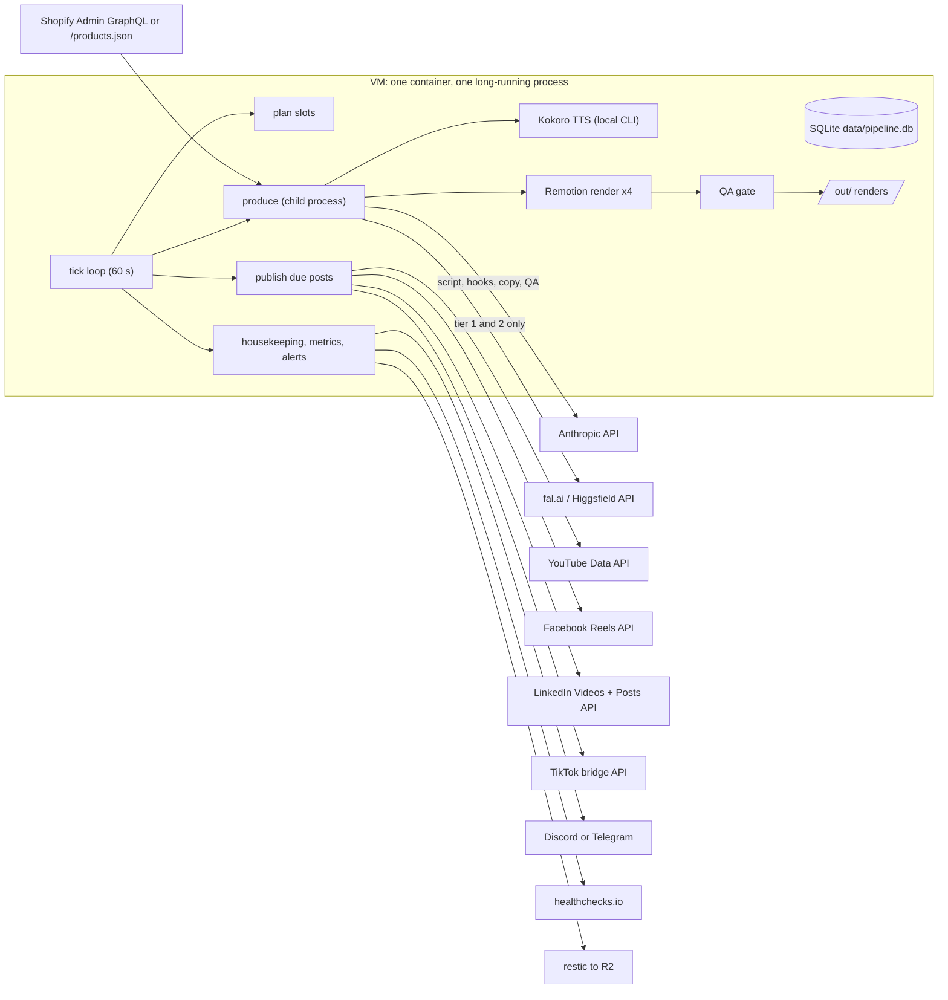

# Architecture

A single container on a small VM turns the store's Shopify product into two 15-second vertical ads
a day and publishes each one to YouTube Shorts, Facebook Page Reels, LinkedIn and TikTok. The
pipeline is ordinary code driven by a SQLite database. Language models are called at four creative
or judgment steps and nowhere else. Nothing listens on a network port.

## What we are advertising

Read from the live store on 2026-11-11:

| | |
|---|---|
| Store | Merry Marts, Oakville, Ontario. Prices in CAD. Ships to Canada only |
| Products | 1: Heated Shawl Wrap (`snugwrap-heated-shawl-wrap`), $49.99 CAD |
| Variants | Beige, Green, Red. One size, 150 × 80 cm |
| Photos | 10, square, 800–1500 px |
| Description | About 60 words: heating function, USB-powered, wearable, materials, gift-box packaging, "Power bank not included" |
| Reviews, sale price | None |

Two consequences shape the design. The facts available for claims are few, so the claim checker
matters and every ad carries the "power bank not included" disclosure. And one product with ten
photos has to carry 60 distinct ads a month, so variation is a first-class part of the system.

## Diagram



## Data flow for one slot

1. **Plan.** The evening before, the planner creates tomorrow's slots. For each it picks a hook,
   a template, a variant (photo order, palette, voice, music) and a tier, avoiding recent combinations.
2. **Ingest.** The product is fetched from Shopify at most once a day and turned into a brief:
   a list of facts with the field each came from, mandatory disclosures, and a tagged photo inventory.
3. **Script.** Sonnet 5.5 writes the script for the chosen hook as structured JSON: four beats, each
   with the spoken line, the on-screen line and the photos to show.
4. **Claim check.** Code checks word count, price strings and banned phrases. Haiku 5.5 then checks
   every claim against the brief. A failure regenerates the script, twice at most.
5. **Voice.** Kokoro synthesizes the lines on the VM and returns word timings.
6. **Hero clip (Tier 1 or 2 only).** The router checks price and remaining budget, generates one
   3–4 second image-to-video clip, and checks it against the source photo.
7. **Master edit.** Everything above is assembled into one edit list (the "master edit"), stored as JSON.
8. **Render.** Remotion renders the master edit four times, once per platform, changing only safe
   zones, caption position and call-to-action wording.
9. **QA.** Each file passes the QA gate or the slot is re-rendered with a different template.
10. **Copy.** Haiku 5.5 writes the per-platform title, caption and hashtags in one call.
11. **Publish.** At each platform's slot time the publisher uploads the file with the right
    AI-disclosure flag and records the post ID.
12. **Measure.** Metrics are pulled later and feed the next week's hook and template choices.

Steps 1, 2, 5, 7, 8, 9 (deterministic part), 11 and 12 are plain code. Steps 3, 4, 10 and the vision
part of 9 call a model. Step 6 calls a video API.

## Runtime shape

One Docker image, one service, started with `docker compose up -d` and restarted by Docker.

The process runs a loop once a minute. Every job reads the database to decide whether it has work,
so a crash, a restart or a missed minute changes nothing: the next tick picks up where the state
says things are.

| Job | Runs when | Does |
|---|---|---|
| `plan` | Daily at `produceAt`, and at startup if tomorrow has no slots | Creates slot rows |
| `produce` | A planned slot has no passing renders | Runs steps 2–10 in a **child process**, one slot at a time, 30-minute timeout |
| `publish` | A ready slot has a platform whose time has come | Uploads, with retry |
| `metrics` | Daily | Pulls post metrics |
| `review` | Weekly | Sonnet reviews performance, updates selection weights |
| `housekeeping` | Daily | Deletes old renders, backs up, checks tokens and disk, sends the daily summary |
| heartbeat | Every tick | Pings the dead-man's switch |

Rendering runs in a child process so that an out-of-memory kill takes the child and not the loop,
and publishing continues while a render is in progress.

There is no cron, no Redis, no queue broker and no web server. The database is the queue.

## Slot and publication states

```
slot:         planned -> producing -> ready -> done
                              \-> failed          (alert; publications skipped)

publication:  pending -> uploading -> published
                 |            \-> pending (retry with backoff)
                 |            \-> needs_attention (ambiguous; alert; never re-posted blindly)
                 \-> skipped (slot failed, or more than maxLateness past its time)
```

A slot ID is `<local date>#<index>`, for example `2026-11-12#1`. A publication is keyed by
`(slot_id, platform)` with a unique constraint. That key is the idempotency key.

### Never double-post

Each platform returns a handle early in its upload flow. The publisher writes that handle to the
database **before** the next step, and on any retry it asks the platform about the handle first.

| Platform | Handle stored | Check before retrying |
|---|---|---|
| YouTube | Resumable session URI | `PUT` with `Content-Range: bytes */<size>` returns the finished video or the resume offset |
| Facebook | `video_id` from `upload_phase=start` | `GET /{video-id}?fields=status` |
| LinkedIn | Video URN from `initializeUpload` | List the author's recent posts and look for one whose media is that URN |
| TikTok (own app) | `publish_id` from `init` | `/v2/post/publish/status/fetch/` |
| TikTok (bridge) | Bridge post ID | Bridge status endpoint |

If the state cannot be resolved, the publication becomes `needs_attention` and an alert goes out.
Missing a post is acceptable. Posting twice is not.

### Retry

Network errors, HTTP 5xx and 429 retry at about 1, 5, 15, 45 and 120 minutes with jitter, until
`maxLateness` (default 6 hours) has passed. A 401 refreshes the token and retries once. Other 4xx
errors fail immediately and alert. An overdue slot is skipped, so a long outage never produces a
burst of posts.

## Creative pipeline

**Brief.** Built from Shopify data only. Each fact records its source field. Tags are used for
angle selection and never as claims ("bestseller" is a tag on a product published three days ago).
Haiku 5.5 with vision tags each photo once: clean product shot, lifestyle, infographic with text,
dominant colours. Photos with embedded text are kept away from caption areas. The brief also
extracts mandatory disclosures.

**Hook library.** Sonnet 5.5 generates hooks in six frameworks: problem-agitate, curiosity gap,
bold claim backed by product data, POV, comparison, objection-flip. Each hook stores its on-screen
text, its spoken line and the facts it relies on. The library starts at 48 and refills when fewer
than 40 are usable. A hook is usable on a platform if it has not been published there in 14 days.
With 2 slots a day the system consumes 28 hooks per 14-day window, which is why the user's floor
of 20 is raised to 40.

**Script.** Four beats: hook (0–2 s), benefit or demo (2–10 s), offer (10–13 s), call to action
with shop name and URL (13–15 s). About 35–40 spoken words. Each caption chunk has two strings:
what is said ("forty-nine ninety-nine") and what is shown ("$49.99").

**Voice and caption timing.** Kokoro-82M runs through a small Python CLI and returns a WAV plus
per-word start and end times. Captions are the script itself, timed by the synthesizer. No speech
recognition is involved, so a caption can never disagree with the script. If the voice-over runs
past 14.5 seconds the script is regenerated shorter.

**Music.** A local library with a manifest that records the licence of every track. Only tracks we
own or CC0 tracks are allowed. Music is ducked under the voice and the mix is normalized to −14 LUFS.

**Render.** A Remotion composition takes the master edit as props. Templates are React components
in `templates/`. Phase 3 ships at least three: bold kinetic type, soft lifestyle with lower-third
captions, and gift-guide cards with the colour variants. The end card always shows the exact price
string from Shopify, the shop name and the product URL.

**Platform derivations.** The same master edit is rendered once per platform with that platform's
safe-zone preset and call-to-action wording. Script, voice, music and hero clip are produced once
per slot. Only the 1–2 minute CPU render repeats.

## Variation engine

Each slot is a point in this space, chosen by a seeded sampler that rejects recent neighbours:

| Dimension | Values | Rule |
|---|---|---|
| Hook | 40+ | Not on the same platform within 14 days |
| Template | 3 at first, more over time | Not the same as the previous slot |
| Photo sequence | Orderings of 10 photos, filtered by tags | Opening photo differs from the last 4 slots |
| Palette | Derived from the three product colours | Rotates |
| Voice | 3–4 Kokoro voices | Rotates |
| Music | Library tracks | Not within the last 3 slots |
| Hero clip | Tier 1 or 2 slots only | New generation each time |
| Caption and hashtags | Written per slot, per platform | Always new |

Phase 8 replaces uniform sampling with weights learned from metrics, keeping a share of slots for
exploration.

## Tier router and budget

| Tier | Visuals | Cost | Default share |
|---|---|---|---|
| 0 | Product photos animated in code | $0 | 50% |
| 1 | Tier 0 plus one open-weight image-to-video hook clip from a hosted pay-per-clip API | ~$0.16 | 40% |
| 2 | Tier 0 plus one premium-model hook clip (Higgsfield API) | ~$0.50 | 10% |

Before any paid job the router reads the price from its table, checks the provider balance where
the API offers one, and checks the month's ledger against the cap. If the cap would be exceeded,
or the call fails twice, the slot falls back to Tier 0. Every job writes a ledger row with quoted
and actual cost. A generated clip is compared with its source photo by Haiku 5.5 and rejected if
the product looks different or text has been invented.

## QA gate

Nothing is published without passing.

| Check | Tool | Pass condition |
|---|---|---|
| Container, codec, size, frame rate | `ffprobe` | MP4, H.264, `yuv420p`, 1080×1920, 30 fps |
| Duration | `ffprobe` | 14.0–16.0 s |
| Audio present and loud enough | `ffmpeg` `ebur128` | AAC stream, −14 ±1.5 LUFS, true peak ≤ −1 dBTP |
| Black frames | `ffmpeg` `blackdetect` | None longer than 0.3 s |
| Frozen picture | `ffmpeg` `freezedetect` | None longer than 2.5 s |
| Silence | `ffmpeg` `silencedetect` | None longer than 1.5 s |
| File size | `stat` | Under the smallest platform limit |
| Captions inside safe zone | Layout code and a unit test | By construction |
| Legibility, clipped or overlapping text, price and shop name on the end card | Haiku 5.5 vision on 6 frames, scored against a rubric | Rubric passes. Can be turned off |

A failure re-renders with the next template, twice at most. Then the slot fails and alerts.

## Model use at runtime

| Step | Model | Notes |
|---|---|---|
| Hooks, scripts, weekly review | `claude-sonnet-5-5` | |
| Per-platform copy, claim check, QA vision, photo tagging, error classification | `claude-haiku-5-5` | |
| Diagnosis after repeated failures | `claude-opus-5-5` | Behind `llm.escalationEnabled`, off by default |

Rules for every call:

- Single request, structured output against a JSON schema. No agent loop, no tools.
- The brand and product context is a stable system prefix with a cache breakpoint. The day's calls
  run back to back so they share it.
- Variety comes from the inputs: framework, angle, and the list of hooks already used. Current
  models reject non-default sampling parameters.
- Tokens, cache reads and dollar cost are written to `llm_calls` for every call. A monthly cap stops
  further calls and alerts.
- `stop_reason` is checked before the content is read. A refusal counts as a failed attempt.
- Product text from Shopify is passed as data. Model output is validated before use: prices must
  match the brief and the only URL allowed is the shop's.
- `LLM_STUB=1` replaces calls with fixtures for tests and for running without a key.

No model session stays open. The process calls the API and moves on.

## Data model

SQLite, one file, WAL mode, plain SQL migrations.

| Table | Holds |
|---|---|
| `products`, `briefs` | Raw Shopify product and the derived brief, versioned by content hash |
| `hooks` | Hook library with framework, texts, facts used, score |
| `slots` | One row per slot: choices, tier, master edit JSON, status, cost |
| `renders` | One row per slot and platform: file path, hash, QA result |
| `publications` | One row per slot and platform: schedule, state, attempts, stored handle, post ID and URL |
| `oauth_tokens` | Current access and refresh tokens per platform |
| `llm_calls`, `spend` | Token and dollar ledger |
| `metrics` | Post metrics over time |
| `events`, `kv` | Audit trail, alert de-duplication, heartbeat, learned weights |

Hook usage is a query over `publications` and `slots`. It has no table of its own.

## Configuration and secrets

`config/pipeline.config.ts` is a typed, commented file: timezone (`America/Toronto`), slot times
per platform, enabled platforms and their modes, tier mix and caps, model names, QA thresholds,
retention. It is validated at startup and the process refuses to start on an invalid config.

`.env` holds every secret and is gitignored. `.env.example` is committed. OAuth tokens that rotate
live in the database, inside the data volume. `DRY_RUN=1` does everything except the publish call
and records what it would have sent.

One-time authorization is a CLI: `pipeline auth youtube|tiktok|linkedin|meta`. It runs on the VM
through an SSH port-forward, so the browser on the owner's machine completes a loopback redirect.

## Operations

- **Logs.** JSON to stdout. Docker rotates them (10 MB × 5).
- **Alerts.** One webhook, Discord or Telegram: publish failure after retries, produce failure,
  token expiring or refresh failing, budget cap reached, QA rejecting repeatedly, disk over 80%,
  slot skipped. The same alert is sent at most once every 6 hours.
- **Daily summary.** Posts published with links, cost month to date, tomorrow's slots, warnings.
- **Dead-man's switch.** A ping to healthchecks.io every tick. If the VM or process dies, that
  service emails. An alert that depends on the dead machine would not arrive.
- **Housekeeping.** Renders older than 14 days are deleted. Database rows are kept.
- **Backups.** Nightly snapshot of the database, which includes tokens, encrypted by restic and
  sent to R2. Seven daily and four weekly copies are kept.
- **`pipeline doctor`.** Checks config, secrets present, token validity and expiry dates, API
  reachability, FFmpeg, fonts, disk, migrations and the LinkedIn version sunset date.

## Security

- No inbound ports except SSH with keys. No web UI and no webhooks: every integration is an
  outbound call.
- The container runs as a non-root user. Secrets are read from the environment and redacted in logs.
- Dependencies are pinned to exact versions with a lockfile. Base images are pinned by digest.
- Third-party code is never piped from the network into a shell. Anything cloned goes to
  `third_party/` and runs in a container.
- Backups are encrypted before they leave the VM.
- Every phase ends with a security review by the Opus reviewer agent.

## Repository layout

```
src/                 one TypeScript package; each folder is a module
  cli.ts             run | plan | produce | publish | metrics | review | auth | doctor
  config/  db/       config loader and validation; SQLite and migrations
  shopify/           product fetch, asset download, brief builder
  creative/  llm/    hooks, script, copy, validators; Anthropic client with caching and cost log
  tts/               wrapper around the Python CLI
  render/  qa/       Remotion render and platform derivations; QA gate
  router/            tier choice, budget ledger, clip providers
  publish/           youtube, facebook, linkedin, tiktok, bridge, oauth, idempotency
  scheduler/  ops/   tick loop and planner; alerts, housekeeping, backup, doctor
  feedback/          metrics pull and ranking
templates/           Remotion compositions (React)
prompts/             versioned prompt files
tools/tts/           Kokoro CLI (Python, uv)
assets/              music with licence manifest, fonts, brand files
config/              pipeline.config.ts
infra/               Dockerfile, docker-compose.yml, setup.sh, backup script
tests/               node --test
docs/                this folder
.claude/agents/  .claude/skills/  .mcp.json  CLAUDE.md
third_party/         vendored or cloned code, containerized
out/  data/          renders and database (gitignored)
```

This differs from the suggested `apps/` plus `packages/` split in one way: the modules are folders
in a single package, with the same names. There is one deployable and one owner, so separate
packages would add nine manifests and a build graph and enforce nothing the folder boundaries do
not. Splitting later is a mechanical move.

TypeScript runs directly on Node 24, which strips types natively, so there is no build step.
Tests use the built-in runner. HTTP uses built-in `fetch`. SQLite uses built-in `node:sqlite`.

## Build-time agents

Defined in `.claude/agents/` with the model in frontmatter.

| Agent | Model | Used for |
|---|---|---|
| `architect` | Opus | Architecture decisions, research synthesis, final review of each phase |
| `security-reviewer` | Opus | Security review of each phase |
| `implementer` | Sonnet | Modules, tests, Docker and infrastructure, integration |
| `scout` | Haiku | Reading docs, licence checks, configs, lint fixes, log triage |

The orchestrator plans, routes, reviews diffs and keeps `DECISIONS.md` current.

## Phases

| Phase | Exit criterion | How it is verified |
|---|---|---|
| 0 Research and plan | These documents | Reviewed against the brief |
| 1 Scaffold | `docker compose up` runs with stubs | Run it. Until Docker is available in WSL, run `node src/cli.ts run --once` natively and state the gap |
| 2 Ingest | Brief JSON for the live product | Inspect the JSON against the store |
| 3 Creative | Three distinct sample ads in `out/samples/` | QA gate passes on each; files sent to the owner |
| 4 Tiers | Router picks tiers by config and logs cost | Tests with a fake provider, then one real clip per paid tier within budget |
| 5 Publishing | One private or unlisted test post per platform | Post IDs fetched back from each API |
| 6 Scheduler and ops | Two slots a day per platform, alerts, summary, cleanup | A compressed-time run in `DRY_RUN`, then one real day |
| 7 Deploy | 48 hours unattended | Logs and the publications table |
| 8 Feedback | Weekly ranking changes the sampler | Weights change after a metrics pull |

## Top risks

1. **Repetitive-content enforcement.** One product at two posts a day is close to what YouTube's
   spam policy describes. Variation and per-platform cadence reduce this. See `PLATFORMS.md`.
2. **TikTok depends on a third-party bridge** for public posts. The adapter is replaceable and the
   fallback is drafts with a manual tap.
3. **LinkedIn Company Page approval** may be refused or slow. Fallback: personal profile or bridge.
4. **Thin product data.** Few facts make for similar scripts. Adding heat settings, warm-up time,
   washing instructions and shipping time to the Shopify description improves every ad.
5. **Supplier photos** may carry embedded text or watermarks. Photo tagging routes around them.
6. **Tokens expire or get revoked.** `doctor`, daily checks and early alerts. Re-authorizing is one command.
7. **Shopify's public JSON endpoint rate-limits** (HTTP 429 seen twice during research). Admin API
   credentials remove this. The last good brief is reused on failure.
8. **Hosting prices and availability are moving.** The deploy script is provider-agnostic.
9. **Voice quality.** Kokoro is good for its size. If it reads as synthetic, a paid voice is a config change.
10. **English only.** If the store markets to Québec, French versions may be required. Kokoro has a French voice.
