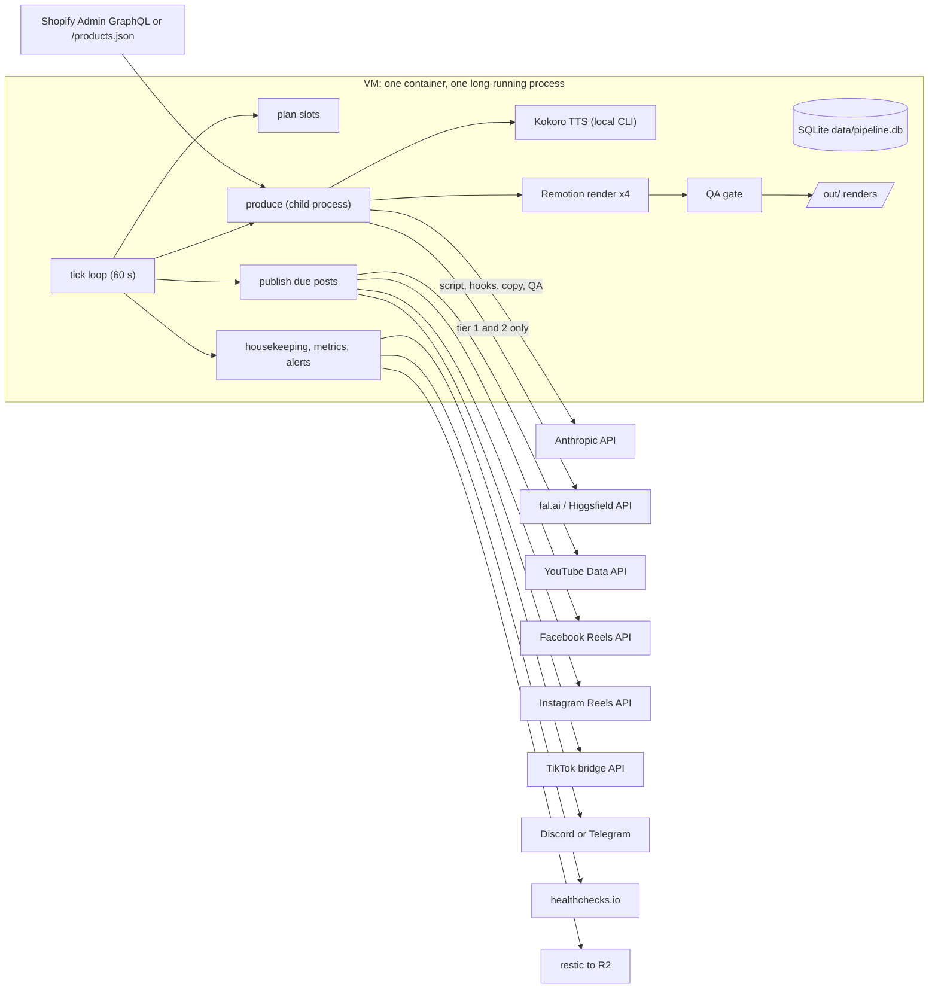

# Architecture

A single container on a small VM turns the store's Shopify product into two 15-second vertical ads
a day and publishes each one to YouTube Shorts, Facebook Page Reels, Instagram Reels and TikTok. The
pipeline is ordinary code driven by a SQLite database. Language models are called only at the
creative and judgment steps listed under "Model use at runtime". Nothing listens on a network port.

## What we are advertising

Read from the live store on 2026-11-11:

| | |
|---|---|
| Store | Giftwell (formerly Merry Marts), Oakville, Ontario. Prices in CAD. Ships to Canada only |
| Products | 1: Heated Shawl Wrap (`snugwrap-heated-shawl-wrap`), $49.99 CAD |
| Variants | Beige, Green, Red. One size, 150 × 80 cm |
| Photos | 10, square, 800–1500 px. Six are supplier infographics with claims printed on them |
| Description | About 60 words: heating function, USB-powered, wearable, materials, gift-box packaging, "Power bank not included" |
| Reviews, sale price | None |

Three consequences shape the design. The facts available for claims are few, so the claim checker
matters and every ad carries the "power bank not included" disclosure. One product with ten photos
has to carry 60 distinct ads a month, so variation is a first-class part of the system. And most
photos carry printed text, so each photo is tagged and cropped to a text-free region before use.

## Diagram



## Data flow for one slot

1. **Plan.** The evening before, the planner creates tomorrow's slots. For each it picks a hook,
   a template, a variant (photo order, palette, voice, music) and a tier, avoiding recent combinations.
2. **Ingest.** The product is fetched from Shopify at most once a day and turned into a brief:
   a list of facts with the field each came from, mandatory disclosures, and a tagged photo inventory.
3. **Script.** Sonnet 5.5 writes the script for the chosen hook as structured JSON: four beats, each
   with the spoken line, the on-screen line and the photos to show.
4. **Claim check.** Code checks word count, price strings and banned phrases. Haiku 5.5 then checks
   every claim against the brief. A failure regenerates the script once.
5. **Voice.** Kokoro synthesizes the lines on the VM and returns word timings.
6. **Hero clip (Tier 1 or 2 only).** The router checks price and remaining budget, generates one
   3–4 second image-to-video clip, and checks it against the source photo.
7. **Master edit.** Everything above is assembled into one edit list (the "master edit"), stored as JSON.
8. **Render.** Remotion renders the master edit four times, once per platform, changing only safe
   zones, caption position and call-to-action wording.
9. **QA.** Each file passes the QA gate or the slot is re-rendered with a different template.
10. **Copy.** Haiku 5.5 writes the per-platform title, caption and hashtags in one call.
11. **Publish.** At each platform's slot time the publisher uploads the file with the right
    AI-disclosure flag and records the post ID.
12. **Measure.** Metrics are pulled later and feed the next week's hook and template choices.

Steps 1, 2, 5, 7, 8, 9 (deterministic part), 11 and 12 are plain code. Steps 3, 4 and 10, the photo
tagging in step 2 and the vision part of step 9 call a model. Step 6 calls a video API.

## Runtime shape

One Docker image, one service, started with `docker compose up -d` and restarted by Docker.

The process runs a loop once a minute. Every job reads the database to decide whether it has work,
so a crash, a restart or a missed minute changes nothing: the next tick picks up where the state
says things are.

| Job | Runs when | Does |
|---|---|---|
| `plan` | Daily at `produceAt`, and at startup if tomorrow has no slots | Creates slot rows |
| `produce` | A planned slot has no passing renders | Runs steps 2–10 in a **child process**, one slot at a time, 30-minute timeout |
| `publish` | A ready slot has a platform whose time has come | Uploads, with retry |
| `metrics` | Daily | Pulls post metrics |
| `review` | Weekly | Sonnet reviews performance, updates selection weights |
| `housekeeping` | Daily | Deletes old renders, backs up, checks tokens and disk, sends the daily summary |
| heartbeat | Every tick | Pings the dead-man's switch |

Rendering runs in a child process so that an out-of-memory kill takes the child and not the loop,
and publishing continues while a render is in progress.

There is no cron, no Redis, no queue broker and no web server. The database is the queue.

## Slot and publication states

```
slot:         planned -> producing -> ready -> done
                 ^            |  \-> failed       (alert; publications skipped)
                 \------------/  a stale 'producing' returns to planned, twice at most

publication:  pending -> uploading -> published
                 |            \-> pending (retry with backoff)
                 |            \-> needs_attention (ambiguous; alert; never re-posted blindly)
                 \-> skipped (slot failed, or more than maxLateness past its time)
```

A slot ID is `<local date>#<index>`, for example `2026-11-12#1`. A publication is keyed by
`(slot_id, platform)` with a unique constraint. That key is the idempotency key.

**Claiming.** A publication is claimed with one statement, `UPDATE … SET state='uploading' … WHERE
state='pending'`, and the upload goes ahead only if that statement changed a row. A manual
`publish` command running beside the loop cannot take the same row.

**Recovery.** A crash or an out-of-memory kill can leave a row in `producing` or `uploading`. Every
tick looks for rows that have been in those states longer than their timeout, 30 minutes each. A
stale `producing` slot goes back to `planned`, and fails with an alert the second time. A stale
`uploading` publication is checked against its stored handle, as described below. Rows younger
than the timeout belong to live work and are left alone.

### Never double-post

Each platform returns a handle early in its upload flow. The publisher writes that handle to the
database **before** the next step, and on any retry it asks the platform about the handle first.

| Platform | Handle stored | Check before retrying |
|---|---|---|
| YouTube | Resumable session URI | `PUT` with `Content-Range: bytes */<size>` returns the finished video or the resume offset |
| Facebook | `video_id` from `upload_phase=start` | `GET /{video-id}?fields=status` |
| Instagram | Container ID from the first call | `GET /{container-id}?fields=status_code`: `PUBLISHED` means done, `FINISHED` means publish it, `EXPIRED` or `ERROR` means start again |
| TikTok (own app) | `publish_id` from `init` | `/v2/post/publish/status/fetch/` |
| Bridge | Our own reference sent with the create call, then the bridge post ID | Bridge status endpoint, or a search of recent bridge posts for our reference. If the bridge offers neither an idempotency key nor a searchable reference, a lost response is `needs_attention` |

If the state cannot be resolved, the publication becomes `needs_attention` and an alert goes out.
Missing a post is acceptable. Posting twice is not.

### Retry

Network errors, HTTP 5xx and 429 retry at about 1, 5, 15, 45 and 120 minutes with jitter, until
`maxLateness` (default 6 hours) has passed. A 401 refreshes the token and retries once. Other 4xx
errors fail immediately and alert. An overdue slot is skipped, so a long outage never produces a
burst of posts.

## Creative pipeline

**Brief.** Built from Shopify data only. Each fact records its source field. Tags are used for
angle selection and never as claims ("bestseller" is a tag on a product published three days ago).
Each photo's usable shots come from `config/photo-tags.json`, which the owner can edit: a crop
free of printed text, what it shows and the colour variant. A photo with no entry is used whole.
Tagging photos automatically with a vision model is planned and not built. Claims that appear
only as text printed on a photo ("three heat levels", "machine washable") are never used. The
brief also extracts mandatory disclosures.

**Hook library.** Sonnet 5.5 generates hooks in six frameworks: problem-agitate, curiosity gap,
bold claim backed by product data, POV, comparison, objection-flip. Each hook stores its on-screen
text, its spoken line and the facts it relies on. A hook is usable on a platform if it has not been
published there in 14 days. The library floor is computed from config as
`noRepeatDays × slots per day × poolFactor`: 14 × 2 × 1.5 = 42 at the defaults, and more when slots
are added. The library starts at 48 and refills by 24 whenever it is below the floor. The brief's
figure of 20 is a minimum, not the target: two slots a day use 28 hooks in every 14-day window.

**Script.** Four beats: hook (0–2 s), benefit or demo (2–10 s), offer (10–13 s), call to action
with shop name and URL (13–15 s). 24 to 32 spoken words: the voice speaks about 2.5 words a second. Each caption chunk has two strings:
what is said ("forty-nine ninety-nine") and what is shown ("$49.99").

**Voice and caption timing.** Kokoro-82M runs through a small Python CLI and returns a WAV plus
per-word start and end times. Captions are the script itself, timed by the synthesizer. No speech
recognition is involved, so a caption can never disagree with the script. Speech must end by
14.8 seconds. If it runs long the voice is synthesized again slightly faster, up to 1.12×, and
after that the script is regenerated.

**Music.** A small Python tool synthesizes an instrumental bed from the slot's seed, so every ad has
its own and we own all of it. Tracks the owner adds to `assets/music/` with a manifest entry take
priority. Music is ducked under the voice and the mix is normalized to −14 LUFS.

**Render.** A Remotion composition takes the master edit as props. Templates are React components
in `templates/`. Phase 3 ships at least three: bold kinetic type, soft lifestyle with lower-third
captions, and gift-guide cards with the colour variants. The end card always shows the exact price
string from Shopify, the shop name and the product URL.

**Platform derivations.** The same master edit is rendered once per platform with that platform's
safe-zone preset and call-to-action wording. Script, voice, music and hero clip are produced once
per slot. Only the 1–2 minute CPU render repeats.

## Variation engine

Each slot is a point in this space, chosen by a seeded sampler that rejects recent neighbours:

| Dimension | Values | Rule |
|---|---|---|
| Hook | 40+ | Not on the same platform within 14 days |
| Template | 3 at first, more over time | Not the same as the previous slot |
| Photo sequence | Orderings of 10 photos, filtered by tags | Opening photo differs from the last 4 slots |
| Palette | Derived from the three product colours | Rotates |
| Voice | 3–4 Kokoro voices | Rotates |
| Music | Library tracks | Not within the last 3 slots |
| Hero clip | Tier 1 or 2 slots only | New generation each time |
| Caption and hashtags | Written per slot, per platform | Always new |

Phase 8 replaces uniform sampling with learned weights.

## Feedback loop

Weights are computed in code. The model does not set them.

- **Metric.** Per post: average watch time divided by video length, where the platform reports it
  (YouTube Analytics, Facebook video insights, Instagram media insights). Otherwise likes plus
  comments plus shares, divided by views. Metrics are read 48 hours after publishing.
- **Normalizing.** A post is a win if it beats the median of the last 30 days on its own platform.
  Platforms are never compared with each other.
- **Sampler.** Thompson sampling over hook framework and template, each with a win count and a loss
  count. It favours winners and keeps trying the rest, so no separate exploration share is needed.
- **Pruning.** A hook with three losses and no win is retired, which triggers the refill.
- **Review.** Once a week Sonnet 5.5 reads the results table and writes a short commentary for the
  daily summary, plus angle suggestions for the next hook refill.
- **Gaps.** A platform without readable metrics is left out of the ranking: TikTok unless the bridge
  exposes analytics.

## Tier router and budget

| Tier | Visuals | Cost | Default share |
|---|---|---|---|
| 0 | Product photos animated in code | $0 | 50% |
| 1 | Tier 0 plus one open-weight image-to-video hook clip from a hosted pay-per-clip API | ~$0.16 | 40% |
| 2 | Tier 0 plus one premium-model hook clip (Higgsfield API) | ~$0.50 | 10% |

Before any paid job the router reads the price from its table, checks the provider balance where
the API offers one, and checks the month's ledger against the cap. It then writes a ledger row
that reserves the quoted cost, submits the job, and stores the provider's job ID on that row. A
restart resumes the stored job and does not submit a second one. A failed or rejected job still
counts at its quoted price. If the cap would be exceeded, or the call fails twice, the slot falls
back to Tier 0. A generated clip is compared with its source photo by Haiku 5.5 and rejected if the
product looks different or text has been invented. A rejected clip is regenerated once. After that
the slot falls back to Tier 0.

The ledger is the first limit. The second is outside our code: each provider account is prepaid,
topped up by hand to no more than its monthly cap, with auto-reload off, and the Anthropic
workspace has a spend limit equal to the model cap. A bug in the ledger cannot spend money that is
not in the account.

The default mix is a starting point. Phase 4 generates the same shot on Tier 1 and on Tier 2 from
the same photo, and the mix is set from that comparison.

## QA gate

Nothing is published without passing.

| Check | Tool | Pass condition |
|---|---|---|
| Container, codec, size, frame rate | `ffprobe` | MP4, H.264, `yuv420p`, 1080×1920, 30 fps |
| Duration | `ffprobe` | 14.0–16.0 s |
| Audio present and loud enough | `ffmpeg` `loudnorm` in measure mode | AAC stream, −14 ±1.5 LUFS, true peak at most −0.7 dBTP |
| Black frames | Every frame decoded to 32×57 greyscale; mean brightness computed in code | No dark run longer than 0.3 s |
| Frozen picture | The same frames; difference between neighbours | No still run longer than 2.5 s |
| Silence | `ffmpeg` `silencedetect` | None longer than 1.5 s |
| File size | `stat` | Under the smallest platform limit |
| Captions inside safe zone | Layout code and a unit test | By construction |
| Captions legible | Computed from the layout: font size, and contrast ratio against the caption plate | At least 56 px and 4.5:1 |
| Clipped or overlapping text, price and shop name on the end card, overall look | Haiku 5.5 vision on 6 frames, scored against a rubric | Planned. Not built yet |

A failure re-renders with the next template, twice at most. Then the slot fails and alerts.

FFmpeg here is the binary that ships with Remotion. It has no `blackdetect`, `freezedetect` or
`ebur128` filter, which is why those checks read raw frames and use `loudnorm`.

## Model use at runtime

| Step | Model | Notes |
|---|---|---|
| Hooks, scripts, weekly review | `claude-sonnet-5-5` | |
| Per-platform copy and claim checks. Planned and not built: QA vision, photo tagging, error classification | `claude-haiku-5-5` | |
| Diagnosis after repeated failures | `claude-opus-5-5` | Behind `llm.escalationEnabled`, off by default |

Rules for every call:

- Single request, structured output against a JSON schema. No agent loop, no tools.
- The brand and product context is a stable system prefix with a cache breakpoint. The day's calls
  run back to back so they share it.
- Variety comes from the inputs: framework, angle, and the list of hooks already used. Current
  models reject non-default sampling parameters.
- Tokens, cache reads and dollar cost are written to `llm_calls` for every call.
- When the monthly cap is reached, or the API is down, the pipeline keeps posting in degraded mode.
  It reuses an approved script whose hook is outside its 14-day window, with a new template, photo
  order, voice and music, and it alerts once. A slot is skipped only when no such script exists.
- Known failures are classified in code by HTTP status and platform error code. Only an
  unrecognized error goes to Haiku, with secrets redacted, to be labelled transient, permanent,
  auth, quota or policy. Transient is retried, which is safe because every retry checks the stored
  handle first. The label and a one-line summary go into the alert.
- `stop_reason` is checked before the content is read. A refusal counts as a failed attempt.
- Product text from Shopify is passed as data. Model output is validated before use: prices must
  match the brief and the only URL allowed is the shop's.
- `LLM_STUB=1` replaces calls with fixtures for tests and for running without a key.

No model session stays open. The process calls the API and moves on.

## Data model

SQLite, one file, WAL mode, plain SQL migrations.

| Table | Holds |
|---|---|
| `products`, `briefs` | Raw Shopify product and the derived brief, versioned by content hash |
| `hooks` | Hook library with framework, texts, facts used, score |
| `slots` | One row per slot: choices, tier, master edit JSON, status, cost |
| `renders` | One row per slot and platform: file path, hash, QA result |
| `publications` | One row per slot and platform: schedule, state, attempts, stored handle, post ID and URL |
| `oauth_tokens` | Current access and refresh tokens per platform |
| `llm_calls`, `spend` | Token and dollar ledger |
| `metrics` | Post metrics over time |
| `events`, `kv` | Audit trail, alert de-duplication, heartbeat, learned weights |

Hook usage is a query over `publications` and `slots`. It has no table of its own.

## Configuration and secrets

`config/pipeline.config.ts` is a typed, commented file: timezone (`America/Toronto`), slot times
per platform, enabled platforms and their modes, tier mix and caps, model names, QA thresholds,
retention. It is validated at startup and the process refuses to start on an invalid config.

`.env` holds every secret and is gitignored. `.env.example` is committed. OAuth tokens that rotate
live in the database, inside the data volume. `DRY_RUN=1` does everything except the publish call
and records what it would have sent.

Each platform has `visibility: 'private' | 'public'`, default `private`: YouTube unlisted, TikTok
`SELF_ONLY`, Facebook with the app in Development mode, Instagram uploaded and processed but not
published. A fresh install cannot post
publicly until the owner changes it. This is how the Phase 5 test posts are made.

One-time authorization is a CLI: `pipeline auth youtube|meta|tiktok` (`meta` covers Facebook and Instagram). It runs on the VM
through an SSH port-forward, so the browser on the owner's machine completes a loopback redirect.

## Operations

- **Logs.** JSON to stdout. Docker rotates them (10 MB × 5).
- **Alerts.** One webhook, Discord or Telegram: publish failure after retries, produce failure,
  token expiring or refresh failing, budget cap reached, QA rejecting repeatedly, disk over 80%,
  slot skipped. The same alert is sent at most once every 6 hours.
- **Daily summary.** Posts published with links, cost month to date, tomorrow's slots, warnings.
- **Dead-man's switches.** Two checks at healthchecks.io, which emails when a ping is missed. One is
  pinged every tick and catches a dead VM or process. The other is pinged only after the daily
  summary has been delivered and catches a dead webhook, which would otherwise hide every alert.
- **Housekeeping.** Renders older than 14 days are deleted. Database rows are kept.
- **Backups.** Nightly `VACUUM INTO` snapshot of the database, which includes tokens. restic
  encrypts the snapshot file and sends it to R2. Seven daily and four weekly copies are kept. The
  restic password and R2 keys must also be kept somewhere off the VM. After a restore, tokens that
  rotated since the snapshot are stale, so a platform with rotating tokens (TikTok in direct mode) is authorized again.
- **`pipeline doctor`.** Checks config, secrets present, token validity and expiry dates, API
  reachability, FFmpeg, fonts, disk, migrations and the Graph API version in use.

## Security

- No inbound ports except SSH with keys. No web UI and no webhooks: every integration is an
  outbound call.
- The container runs as a non-root user. Secrets are read from the environment and redacted in logs.
- Dependencies are pinned to exact versions with a lockfile. Base images are pinned by digest.
- Third-party code is never piped from the network into a shell. Anything cloned goes to
  `third_party/` and runs in a container.
- Backups are encrypted before they leave the VM.
- Every phase ends with a security review by the Opus reviewer agent.

## Repository layout

```
src/                 one TypeScript package; each folder is a module
  cli.ts             run | plan | produce | publish | metrics | review | auth | doctor
  config/  db/       config loader and validation; SQLite and migrations
  shopify/           product fetch, asset download, brief builder
  creative/  llm/    hooks, script, copy, validators; Anthropic client with caching and cost log
  tts/               wrapper around the Python CLI
  render/  qa/       Remotion render and platform derivations; QA gate
  router/            tier choice, budget ledger, clip providers
  publish/           youtube, facebook, instagram, tiktok, bridge, oauth, idempotency
  scheduler/  ops/   tick loop and planner; alerts, housekeeping, backup, doctor
  feedback/          metrics pull and ranking
templates/           Remotion compositions (React)
prompts/             versioned prompt files
tools/tts/           Kokoro CLI (Python, uv)
assets/              music with licence manifest, fonts, brand files
config/              pipeline.config.ts
compose.yaml         the deployment
infra/               Dockerfile, setup.sh, backup script
tests/               node --test
docs/                this folder
.claude/agents/  .claude/skills/  .mcp.json  CLAUDE.md
third_party/         vendored or cloned code, containerized
out/  data/          renders and database (gitignored)
```

This differs from the suggested `apps/` plus `packages/` split in one way: the modules are folders
in a single package, with the same names. There is one deployable and one owner, so separate
packages would add nine manifests and a build graph and enforce nothing the folder boundaries do
not. Splitting later is a mechanical move.

TypeScript runs directly on Node 24, which strips types natively, so there is no build step.
Tests use the built-in runner. HTTP uses built-in `fetch`. SQLite uses built-in `node:sqlite`.
FFmpeg is the binary Remotion ships.

## Build-time agents

Defined in `.claude/agents/` with the model in frontmatter.

| Agent | Model | Used for |
|---|---|---|
| `architect` | Opus | Architecture decisions, research synthesis, final review of each phase |
| `security-reviewer` | Opus | Security review of each phase |
| `implementer` | Sonnet | Modules, tests, Docker and infrastructure, integration |
| `scout` | Haiku | Reading docs, licence checks, configs, lint fixes, log triage |

The orchestrator plans, routes, reviews diffs and keeps `DECISIONS.md` current.

## Phases

| Phase | Exit criterion | How it is verified |
|---|---|---|
| 0 Research and plan | These documents | Reviewed against the brief |
| 1 Scaffold | `docker compose up` runs with stubs | Run it. Until Docker is available in WSL, run `node src/cli.ts run --once` natively and state the gap |
| 2 Ingest | Brief JSON for the live product | Inspect the JSON against the store |
| 3 Creative | Three distinct sample ads in `out/samples/` | QA gate passes on each; files sent to the owner |
| 4 Tiers | Router picks tiers by config and logs cost | Tests with a fake provider, then one real clip per paid tier within budget |
| 5 Publishing | One private or unlisted test post per platform | Post IDs fetched back from each API |
| 6 Scheduler and ops | Two slots a day per platform, alerts, summary, cleanup | A compressed-time run in `DRY_RUN`, then one real day |
| 7 Deploy | 48 hours unattended | Logs and the publications table |
| 8 Feedback | Weekly ranking changes the sampler | Weights change after a metrics pull |

## Top risks

1. **Repetitive-content enforcement.** One product at two posts a day is close to what YouTube's
   spam policy describes. Variation and per-platform cadence reduce this. See `PLATFORMS.md`.
2. **TikTok depends on a third-party bridge** for public posts. The adapter is replaceable and the
   fallback is drafts with a manual tap.
3. **Meta app access.** Publishing to our own Page and Instagram account with Standard Access is
   expected to work and is unverified until the Phase 5 test. Fallback: App Review and Business Verification.
4. **Thin product data.** Few facts make for similar scripts. Adding heat settings, warm-up time,
   washing instructions and shipping time to the Shopify description improves every ad.
5. **Supplier photos** may carry embedded text or watermarks. The owner's crop file, `config/photo-tags.json`, routes around them.
6. **Tokens expire or get revoked.** `doctor`, daily checks and early alerts. Re-authorizing is one command.
7. **Shopify's public JSON endpoint rate-limits** (HTTP 429 seen twice during research). Admin API
   credentials remove this. The last good brief is reused on failure.
8. **Hosting prices and availability are moving.** The deploy script is provider-agnostic.
9. **Voice quality.** Kokoro is good for its size. If it reads as synthetic, a paid voice is a config change.
10. **English only.** If the store markets to Québec, French versions may be required. Kokoro has a French voice.
